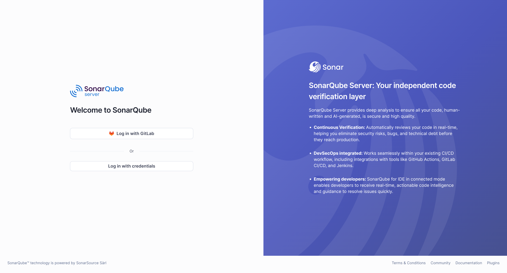
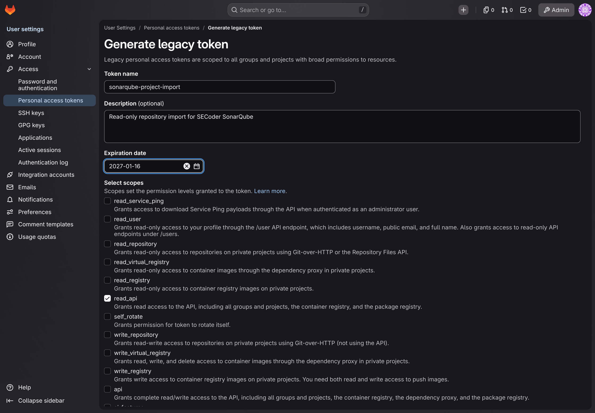
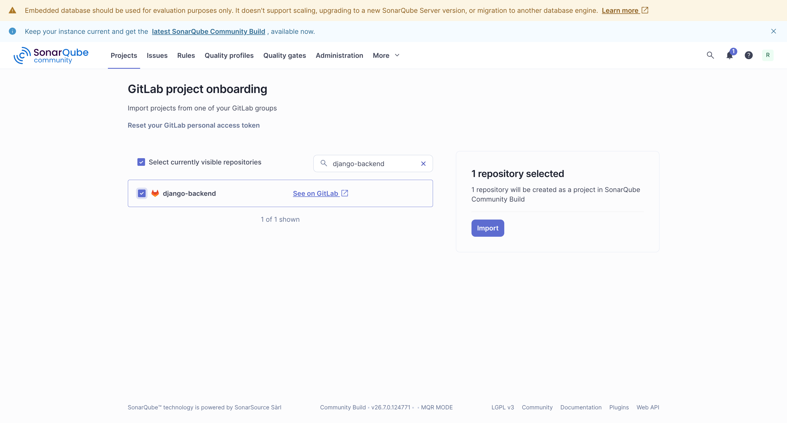
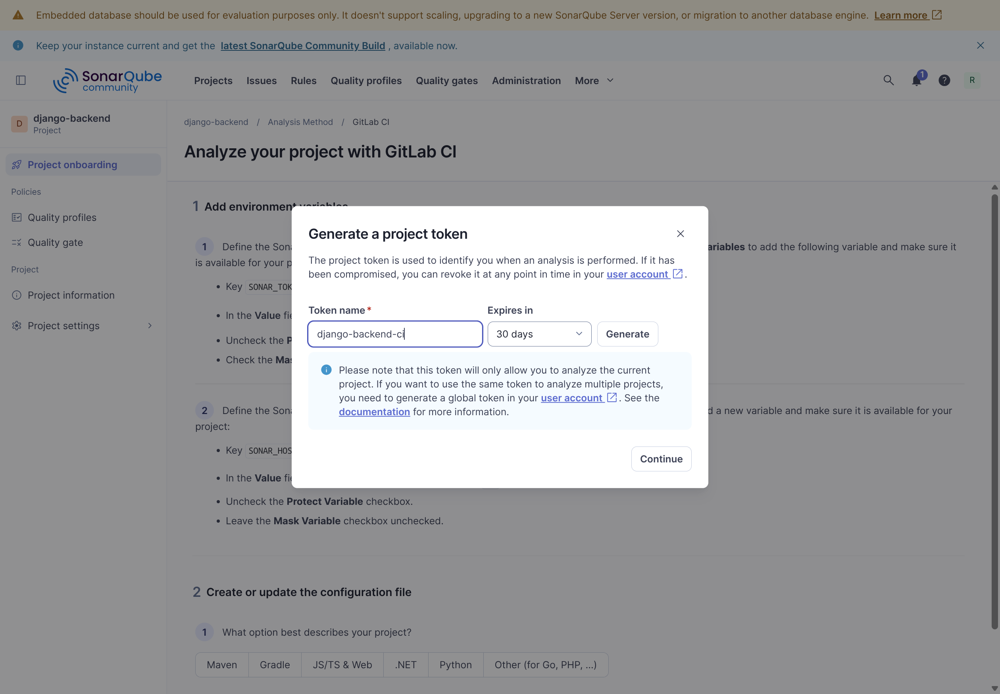
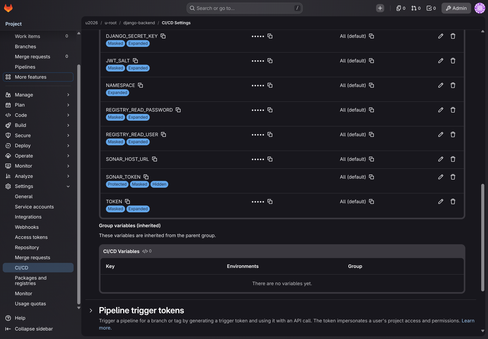
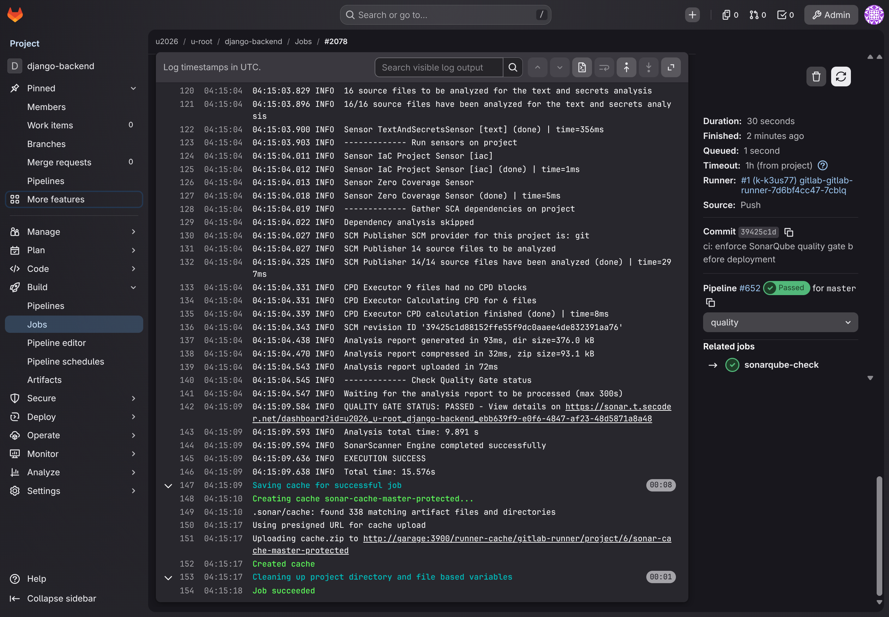
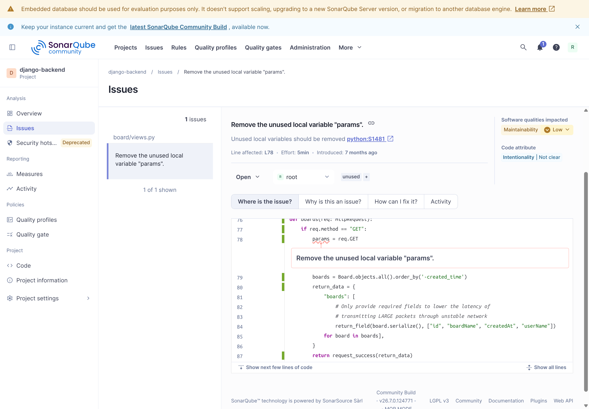
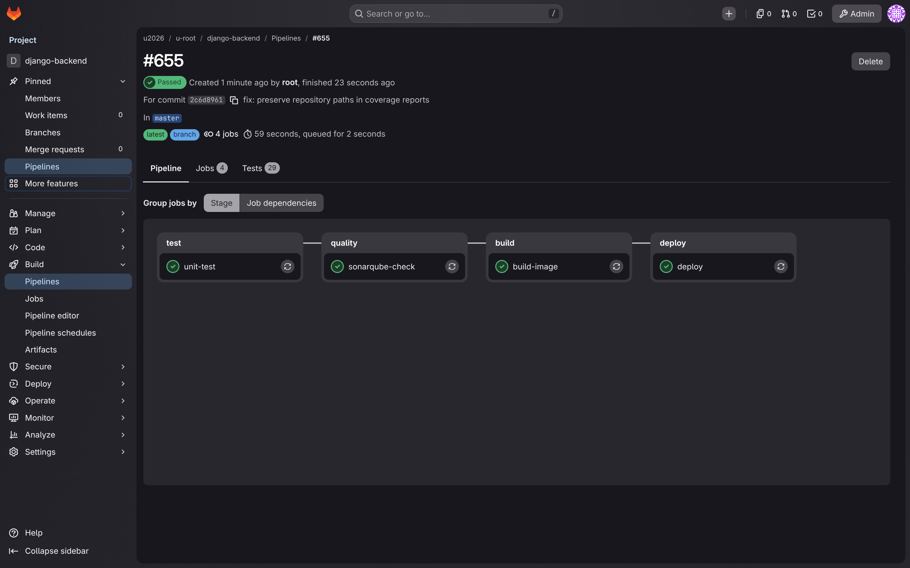
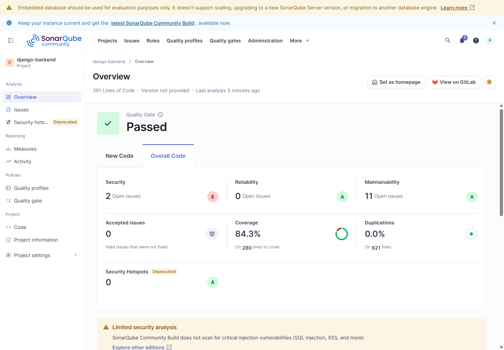
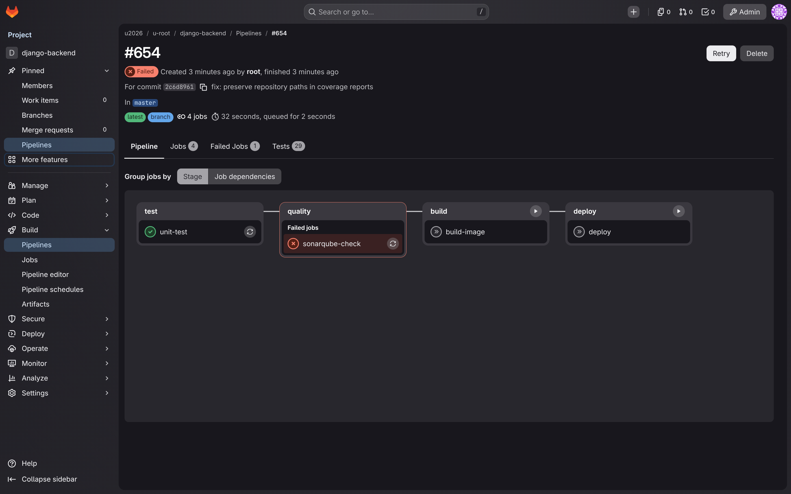

# 代码质量检查（SonarQube）

SonarQube 会分析源代码和测试报告, 帮助你发现潜在错误、安全问题与维护成本较高的写法. 本章以 Django 后端为例, 将分析接入 GitLab CI/CD: 测试通过后执行扫描, 质量门禁通过后再构建和部署.

## 登录并导入项目

1. 从 SECoder 概览页进入 [SonarQube](https://sonar.t.secoder.net), 点击 **Log in with GitLab**. 首次使用时先完成 GitLab 的 SECoder 登录.

    

2. 在 SonarQube 的项目页选择 **Create Project → From GitLab**. 页面提示提供 GitLab Personal Access Token 时, 到 GitLab 的 **头像菜单 → Edit profile → Access → Personal access tokens** 创建令牌.

    当前 GitLab 的入口为 **Generate token → Legacy token**. 填写名称和到期日期, 权限只勾选 **read_api**, 创建后立即复制令牌. 该令牌用于读取仓库列表并导入项目.

    

3. 将令牌填写到 SonarQube 的导入页面并保存. 搜索自己的仓库, 核对 **See on GitLab** 的地址, 勾选后点击 **Import**.

    

4. 新代码定义选择 **Follows the instance’s default**, 再点击 **Create project**. 创建完成后选择 **With GitLab CI**, 语言选择 **Python**.

截图中的 `django-backend` 是演示项目. 配置自己的项目时, 使用自己的仓库和导入后生成的 Project Key.

## 配置分析令牌

在 GitLab CI 引导页点击 **Generate a token**, 为当前项目生成 Project Analysis Token, 设置名称和合适的有效期. 令牌只用于分析当前项目; 页面只显示一次, 创建后立即复制到 CI/CD 变量中.



进入 GitLab 项目的 **Settings → CI/CD → Variables**, 添加:

| Key | Value | 设置 |
| --- | --- | --- |
| `SONAR_HOST_URL` | `https://sonar.t.secoder.net` | 普通变量 |
| `SONAR_TOKEN` | 刚生成的 SonarQube Project Analysis Token | Masked and hidden, Protected; 关闭变量展开 |

本章只扫描默认分支. 默认分支需要在 **Settings → Repository → Branch rules** 中设为 Protected, 才能读取 Protected 的分析令牌. 若引导页建议取消 Protect Variable, 以本章的分支规则与变量设置为准.



GitLab PAT 用于导入仓库, `SONAR_TOKEN` 用于上传分析结果, 部署使用的 `TOKEN` 则是 Kubernetes API 令牌. 分别保存它们, 到期或轮换后更新对应位置. 截图、仓库和日志中都应隐藏完整凭据.

## 生成测试报告

SonarQube 读取测试工具生成的报告. Django 示例使用 Python 3.11、pytest 和 Coverage.py, 先安装项目依赖, 再执行测试.

在仓库根目录增加 `.coveragerc`:

```ini
[run]
relative_files = True
source = .
omit =
    manage.py
    */tests.py
    */migrations/*

[xml]
output = coverage-reports/coverage.xml
```

`source = .` 使报告中的文件名保留 `board/`、`DjangoHW/` 等目录前缀, 避免多个 `__init__.py` 产生歧义. 相对路径也便于扫描作业在下载产物后找到同一份源码.

在现有 `pytest.ini` 中增加:

```ini
junit_family = xunit1
```

这样生成的 JUnit 报告包含文件位置信息, 便于 SonarQube 对应到测试文件. 保留原有的 Django settings 和测试文件匹配规则.

`test.sh` 使用:

```sh
coverage run -m pytest --junit-xml=xunit-reports/xunit-result.xml
ret=$?
coverage xml -o coverage-reports/coverage.xml
coverage report
exit "$ret"
```

脚本会输出覆盖率与测试执行报告, 并保留 pytest 的退出状态. 测试失败时, 流水线应停止.

## 配置扫描范围

在根目录的 `sonar-project.properties` 中填写:

```properties
sonar.projectKey=替换为导入项目时生成的ProjectKey
sonar.projectName=django-backend
sonar.sources=DjangoHW,board,utils
sonar.tests=board
sonar.test.inclusions=board/tests.py
sonar.inclusions=DjangoHW/**/*.py,board/**/*.py,utils/**/*.py
sonar.exclusions=**/__pycache__/**,**/migrations/**,board/tests.py
sonar.python.version=3.11

sonar.python.coverage.reportPaths=coverage-reports/coverage.xml
sonar.python.xunit.reportPath=xunit-reports/xunit-result.xml
```

- `sonar.sources` 指定业务源码根目录, 注意属性名末尾有 **s**.
- `sonar.tests` 与 `sonar.test.inclusions` 指定测试文件. `board/tests.py` 从业务源码中排除后, 仍作为测试代码参与分析.
- `sonar.inclusions` 和 `sonar.exclusions` 控制源码分析范围; `**` 匹配任意层级目录.
- 两个报告路径必须对应测试作业实际生成并上传的文件.

这个示例对应 `board/tests.py` 的目录结构. 项目的测试放在其他位置时, 应同时调整测试分类、Coverage.py 配置与报告路径.

## 将质量门禁加入流水线

在现有 `.gitlab-ci.yml` 中合入下面的质量检查配置. 构建和部署继续使用项目已有的 BuildKit 与 Kustomize 配置.

```yaml
stages:
  - test
  - quality
  - build
  - deploy

sonarqube-check:
  image:
    name: sonarsource/sonar-scanner-cli:11
    entrypoint: [""]
  stage: quality
  variables:
    SONAR_USER_HOME: "${CI_PROJECT_DIR}/.sonar"
    GIT_DEPTH: "0"
  cache:
    key: "sonar-cache-$CI_COMMIT_REF_SLUG"
    paths:
      - .sonar/cache
  needs:
    - job: unit-test
      artifacts: true
  script:
    - test -s coverage-reports/coverage.xml
    - test -s xunit-reports/xunit-result.xml
    - sonar-scanner -Dsonar.host.url="${SONAR_HOST_URL}" -Dsonar.qualitygate.wait=true -Dsonar.qualitygate.timeout=300
  allow_failure: false
  rules:
    - if: '$CI_COMMIT_BRANCH == $CI_DEFAULT_BRANCH'
```

测试作业 `unit-test` 应通过 `sh test.sh` 生成报告, 并配置产物:

```yaml
  artifacts:
    when: always
    reports:
      junit: xunit-reports/xunit-result.xml
    paths:
      - coverage-reports/coverage.xml
      - xunit-reports/xunit-result.xml
```

`needs: artifacts: true` 让扫描作业下载这些文件. `GIT_DEPTH: "0"` 保留分析所需的提交历史. `sonar.qualitygate.wait=true` 会等待服务端计算质量门禁; 门禁不通过或等待超时, 扫描作业都会失败.

镜像构建放在 `build` 阶段, 通过阶段顺序等待质量检查. 部署作业还应显式依赖扫描成功, 将以下依赖合入已有配置:

```yaml
deploy:
  stage: deploy
  needs:
    - job: build-image
      artifacts: true
    - job: sonarqube-check
      artifacts: false
  rules:
    - if: '$CI_COMMIT_BRANCH == $CI_DEFAULT_BRANCH'
```

GitLab 的 `needs` 可以跨越阶段直接调度作业, 因此已有依赖列表也必须纳入质量检查. 扫描与部署使用相同的默认分支规则, 避免部署依赖一个未被创建的作业.

课程扫描模板需要直接内联到项目中. 模板默认的 `allow_failure: true` 应改为本章使用的 `false`, 才能形成严格门禁.

## 查看扫描与门禁结果

提交并推送后, 在 GitLab **Build → Pipelines** 检查 `unit-test`、`sonarqube-check`、`build-image`、`deploy` 的状态. 扫描日志末尾应出现 `QUALITY GATE STATUS: PASSED`, 并提供项目结果链接.



在 SonarQube 项目中查看:

- **Overview**: 质量门禁与主要指标.
- **Issues**: 问题的规则、严重程度、代码位置与修复建议.
- **Security Hotspots**: 需要结合业务场景审核的安全敏感代码.
- **Measures**: 覆盖率、测试结果、重复率与复杂度等数据.



当前实例的 `Sonar way` 主要检查新代码: 新增问题为 0、覆盖率至少 80%、重复率不超过 3%、安全热点审核率达到 100%. 小规模变更的覆盖率和重复率可能按实例规则豁免, 实际判定以项目 **Quality gate** 页面为准.

**New Code** 与 **Overall Code** 的范围不同. 首次分析用于建立基线, 门禁通过后整体代码中仍可能有历史问题. 阅读结果时应同时检查整体指标和问题列表, 并在后续提交中持续整改; 门禁通过不能替代对整个项目的检查.





## 常见问题

| 现象 | 检查方式 |
| --- | --- |
| 导入页面看不到仓库 | 核对 GitLab 登录账号、项目成员权限和 PAT 的 `read_api` scope; 令牌到期后重新配置 |
| 扫描鉴权失败 | 核对 `SONAR_TOKEN` 的类型、项目、有效期, 以及扫描分支是否能读取 Protected 变量 |
| 报告不存在或覆盖率无数据 | 先检查测试产物, 再核对 `needs`、报告路径、XML 中的 source 和文件名 |
| 日志提示文件路径有歧义 | 保留相对于仓库根目录的完整路径, 尤其注意多个同名文件 |
| 质量门禁失败 | 查看失败条件和新代码范围, 修复问题后重新提交; 安全热点按实际用途审核 |
| 扫描失败仍执行部署 | 检查 `allow_failure`、阶段顺序和部署作业的 `needs` |

本例用一条单独的验收流水线覆盖为无效的 `SONAR_TOKEN`, 验证扫描鉴权失败后, `build-image` 和 `deploy` 都被跳过. 该变量仅对这条验收流水线生效; 随后的正常流水线继续使用项目原有分析令牌.



配置成功后, 应能看到与当前提交 SHA 对应的分析记录、正确的测试数量和覆盖率, 且扫描失败时构建和部署被阻断.

## 参考资料

- [SonarQube GitLab CI 配置](https://docs.sonarsource.com/sonarqube-community-build/devops-platform-integration/gitlab-integration/adding-analysis-to-gitlab-ci-cd)
- [Python 测试覆盖率](https://docs.sonarsource.com/sonarqube-community-build/analyzing-source-code/test-coverage/python-test-coverage)
- [测试执行报告参数](https://docs.sonarsource.com/sonarqube-community-build/analyzing-source-code/test-coverage/test-execution-parameters)

流水线基础见 [GitLab CI/CD](gitlab-ci.md), 应用发布配置见 [Kubernetes 部署](deployer.md), 后端作业要求见[后端部署](../handout/ci-cd/backend.md).
